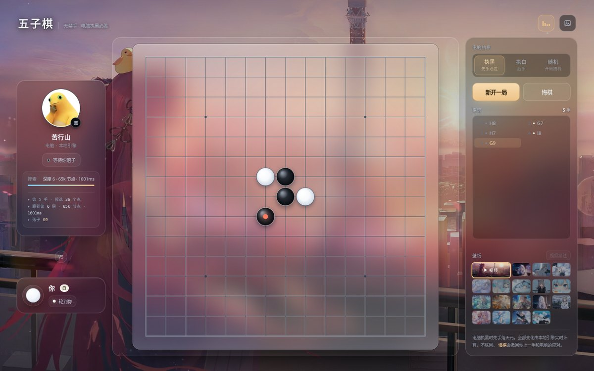

[English](README.md) | [简体中文](README_Simplified_Chinese.md) | [繁體中文](README_Classical_Chinese.md)

# Gomoku

A Gomoku that runs entirely in your browser. Double-click `gomoku.html` and play — no network, no install, no third-party dependencies.

The computer plays, and **as Black it is essentially unbeatable** — it carries an Alpha-Beta engine (9-cell pattern lookup + incremental potential evaluation + transposition table + VCF continuous-fours). It does not play from memorized games.



---

## Quick start

1. Extract the whole folder (**don't take just `gomoku.html`** — the backgrounds and music live in `assets/`).
2. Double-click `gomoku.html` and open it in Chrome / Edge / Safari / Firefox.
3. Click an intersection to place a stone. The computer answers by itself.

Background music starts on first load. If the browser blocks autoplay, click anywhere on the page to start it.

---

## Directory layout

```
gomoku/
├── gomoku.html            The game itself (HTML + CSS + JS + engine, all inlined)
├── README.md              This file
└── assets/
    ├── bgm.mp3            BGM: Ascetic Mountain on the Roof
    ├── avatar-ai.png      Computer's avatar
    ├── preview.jpg        UI preview (README only, safe to delete)
    ├── audio/
    │   └── end-laugh.mp3  End-of-game sound (plays when the game is over)
    ├── video/             Video background
    │   ├── bg-loop.mp4    Seamless-loop background video (1600×900 / 30fps / ~7MB)
    │   ├── poster.jpg     Video poster
    │   └── thumb.jpg      Video thumbnail in the wallpaper wall
    └── bg/                17 background images
        ├── bg01.jpg
        ├── bg02.png
        └── …
```

---

## Interface layout

```
┌────────────────────────────────────────────────────────────┐
│  Gomoku                                        ♪   🖼       │
├──────────┬──────────────────────────┬──────────────────────┤
│ AI card  │                          │ You play (3 ways)    │
│  avatar  │    Frosted board         │ New game / Undo      │
│ Kushan   │  (wallpaper shows        │ Move log             │
│  status  │   through the glass)     │ 17 wallpapers/video  │
│  VS      │                          │                      │
│ You      │                          │                      │
│ (stone)  │                          │                      │
└──────────┴──────────────────────────┴──────────────────────┘
```

- **Top left** is your opponent "Kushan" (苦行山), the only side with an avatar; the ring around it spins while it thinks.
- **Bottom left** is you, marked by a single stone instead of an avatar, its color following Black/White.
- **Center** is the frosted-glass board: `backdrop-filter` blurs the wallpaper or video behind it in real time, letting the background's color blocks show through, with a frosted falloff and highlight along the glass edges.
- **Both side cards are frosted glass too**: translucent base + live blur + a very fine grain layer.
- **Right side** holds every control.

---

## How to play

### Whether you play Black or White

Pick one of three on the right panel — **switching starts a new game**:

The three buttons choose which side **you** take; the computer takes the other. The page defaults to "play White" — that is, **the computer plays Black and moves first**, opening at tengen.

| Option | Meaning |
|---|---|
| **Black (you move first)** | You play Black and move first, computer White. Pick this to open the game yourself |
| **White (computer first)** | **Default.** Computer plays Black and moves first; every move after that is its calculation |
| **Random (random sides)** | Assigned at random each game; the panel shows the result for this game |

### Rules

- 15×15 board, **no forbidden moves**; five in a row in any direction wins.
- A full board with no five is a draw.

### Controls

| Action | How |
|---|---|
| Place a stone | Click a board intersection |
| Undo | "Undo" button, or press `U` |
| New game | "New game", or press `N` |
| Change wallpaper | Click any thumbnail under "Wallpaper"; the 🖼 button in the top bar advances to the next one |
| Video background | The first cell of the wallpaper wall, "▶ Video"; once selected it loops, and auto-rotation stops |
| Auto-rotate | The "Auto-rotate" switch at the wallpaper's top right; when on, changes every **1 minute** (no rotation in video mode) |
| Music toggle | ♪ button, top right |
| End-of-game sound | Plays automatically on a win or a draw, no action needed |

**Undo** steps back two moves — the stone you just played plus the computer's reply — returning to the position before your move. It also works after the game is over, which re-enters play.

---

## The computer's thinking, as text

The board carries no halos or glows. The computer's thoughts go straight into the text box on the left card, updating while it searches:

```
▸ Move 5 · 36 candidate points
▸ Depth 8 · 62.0k nodes
▸ Currently likes G6
```

| Line | Meaning |
|---|---|
| Line 1 | Which move it is, and how many candidate points near the stones are being evaluated |
| Line 2 | Iterative-deepening depth reached, nodes searched so far |
| Line 3 | "Currently likes" mid-search; becomes "Play X" once the search finishes |

**No forced delay**: the engine moves as soon as it finishes, and this line stays until the next move, so a fast search won't just flash by.

The engine prefers to run inside a `Web Worker`, so the interface never stutters. When you open `gomoku.html` directly (the `file://` protocol), the browser refuses to start a `Blob Worker`, so it falls back to **in-page time-sliced search**: it yields the main thread once per depth, so those three lines still refresh level by level — only the deep layer pauses briefly.

---

## Algorithm and strength

The engine is a pure front-end searcher: no game-record library, no network, no server.

### Pattern recognition: every empty point, every direction

Before moving it answers one question — **if I play this point, what does this direction become**. For each of a point's 4 directions it takes the 9 cells centered on it, encodes them as a base-3 number (0 empty / 1 mine / 2 theirs or wall), and looks up a precomputed 19,683-entry table to get the pattern class directly:

| Class | Pattern | Meaning |
|---|---|---|
| 6 | Five | Playing here wins |
| 5 | Open four | Two winning points, cannot be blocked |
| 4 | Four | One winning point, the opponent must answer |
| 3 | Open three | Can become an open four next move |
| 2 | Closed three | A three with one end blocked |
| 1 | Open two | Still developing |
| 0 | None | — |

This classification recognizes **broken three** "●●_●", **broken four** "●●_●●", and **both-ends-blocked** shapes that a 5-cell window count cannot see — which is the fundamental reason it defends better than the previous version.

### A move recomputes only the affected directions

Every empty point maintains "what class if Black plays here, what class if White plays here" × 4 directions — 1,800 numbers. Placing a stone only affects empty points within ±4 cells on the same lines, so a move recomputes about 30 points along a single direction each and leaves the rest untouched; the evaluation score is adjusted incrementally in the same way, so leaf nodes get their score in O(1).

### Evaluation: aggregate per cell, don't let fours farm points

For each empty cell, take "strongest direction + 0.45 × second strongest" as that cell's potential, then sum over all empty cells:

| Pattern | Weight |
|---|---|
| Open four | 1,500,000 |
| Four | 26,000 |
| Open three | 1,200 |
| Closed three | 80 |
| Open two | 10 |

Aggregating per cell rather than adding the 4 directions together is deliberate: the latter lets a point that "makes several fours in one move" be scored over and over — and the computer would then wallow in a pile of fours the opponent casually blocks. "Strongest + 0.45 × second" keeps the value of double-three and four-three combinations while not letting four low-value patterns farm points.

Five-points **do not enter the potential**; they are counted per cell separately, because "the opponent can make five next" does not mean "I win" — it depends on whose turn it is. In evaluation:

- My turn and I can make five → immediate win score
- The opponent has two or more five-points (open four) → immediate loss score
- The opponent has exactly one five-point → I must block, minus a tempo bonus

Every stone also carries a **positional value** (higher toward the center). Without it, opening at tengen and a stone hugging the edge would score equally flat, the computer would underestimate the initiative, and playing Black would get worse and worse.

### Search

| Mechanism | Purpose |
|---|---|
| Iterative deepening | Start at depth 2 and deepen level by level; stop when time runs out, keep only the last complete level |
| Transposition table | 64K-entry Zobrist table caching "position → score + best move" |
| PVS | Full window for the first move, null windows for the rest, re-search after a fail-high |
| Killer moves | Two moves that recently caused a cutoff, remembered per ply and tried first |
| Candidate pruning | Only within 2 cells of a stone, sorted by "my class + 1.05 × opponent's class", top 8–16 |
| Forcing moves | Can make five → play it; opponent can make five → consider blocks only; can make an open four → play it |
| Time slicing | Yield the main thread once per depth so the interface can refresh "depth N" |

**Defense is weighted slightly above offense** (1.05). A point where the opponent could make an open four always sorts to the front of the candidate list and cannot be squeezed out by my own attack — the key to never missing a defense.

### Kills

VCF (continuous fours) runs before the main search: up to 18 plies, 420 ms budget. If a forced line of "four after four until five" exists, it plays it immediately. The recursion checks whether the opponent can counter-five, to avoid announcing phantom kills.

Before moving there is one more self-check: play the chosen move, then run VCF once from the opponent's perspective. If the opponent can kill with continuous fours, switch to the second or third candidate. This specifically cures moves that "look dominant but actually hand over the kill".

### Measured results

Same-process self-play, no random noise, per-move time limit:

| Opponent | Result |
|---|---|
| Rule-based defensive AI (make five / block five / block open four, hardly ever misses a kill) | Black 5 : 0 |
| Rule-based + its own continuous-four kill (closer to a human who can calculate kills, randomized) | Black 18 : 0 |
| This engine against itself, with White given 2 extra seconds (3200 vs 5200) | Black 3 : 0 |
| This engine against itself (White 1800 ms) | Black 2 : 0 |
| The previous engine (1600 ms) | Black 4 : 0 |
| Black given only 1200 ms, against "rule-based + four-kill" | Black 6 : 0 |

Two more rounds were run in the browser:

- A script simulating a player who **places stones at random**: killed in 11–13 moves.
- A script simulating a **rule-abiding** player (makes five when it can, blocks when you could make five, otherwise plays by proximity): 4 games in a row, all won by the computer, killed in 9–11 moves.

### About "unbeatable"

- The page gives the computer Black by default (you play White), so on load you see it open at tengen; the first 6 moves get an extra 0.9 s so the opening doesn't scatter.
- This is an **engineering-grade guarantee**: across more than forty accumulated games against "rule-based defensive AI / rule-based with four-kills / the previous engine / itself (with White given 2 extra seconds)", the computer as Black won every single one, never forced into a draw or a loss.
- But it is not a mathematical proof. Gomoku without forbidden moves is a theoretical win for Black, yet exhaustively verifying that in JS within 3 seconds is unrealistic, so in principle a move set designed specifically against it may still exist. In everyday play, don't count on winning.
- No such guarantee when the computer plays White — the initiative belongs to Black, and winning as White is the reasonable outcome.

## Customization

Everything is in `gomoku.html`; search for the identifier in a text editor:

| What you want to change | Search for | Notes |
|---|---|---|
| Thinking time | `aiThinkTime` | Black 3200 ms / White 1800 ms, plus 900 ms for the first 6 moves; bigger is stronger and slower |
| Search depth cap | `maxDepth: 14` | Level cap passed to the engine; the actual depth is limited by time |
| VCF depth / time limit | `findVCFMove(me, 18, Math.min(420, …))` | Plies and time cap for continuous fours |
| Music volume | `audio.volume` | Default `0.34`, range 0–1 |
| Board colors | `paintScene` | Currently translucent neutral glass + deep blue-gray grid; change the gradients here for wood tones |
| Board transparency | `glassAlpha` | Images 0.06–0.15, video fixed at 0.13; smaller is more transparent |
| Board blur | `backdrop-filter` on `.board-box` | Default `blur(26px) saturate(1.38) brightness(1.01)` |
| Card frosted glass | `backdrop-filter` on `.card` | Default `blur(32px) saturate(1.65) brightness(1.06)`, with `background-color` around 0.38 |
| Image rotation period | `60000` | Milliseconds between auto-rotations; currently 1 minute |
| Background blur | `filter:blur(3.5px)` on `.bg-layer` | Set to 0 for a fully sharp background (it will compete with the interface) |
| Change background images | `BG_LIST` array | Put your images in `assets/bg/` and edit the filenames in the array |
| Change background video | `VIDEO_BG` | Default `assets/video/bg-loop.mp4`; replace under the same name |
| Change music | `assets/bgm.mp3` | Replace under the same name |
| Change end-of-game sound | `assets/audio/end-laugh.mp3` | Replace under the same name, any length |
| End-of-game sound volume | `sfx.volume` in `playEndSfx` | Default `1`; try ~0.5 if it is too loud |
| Music ducking depth | `audio.volume = 0.09` in `playEndSfx` | The level the BGM drops to while the laugh plays |
| Board size | `var N = 15` | Note: the star-point coordinates are hard-coded in `paintScene`, so change both together |

The wallpaper choice is stored in the browser's `localStorage` (key `gomoku_bg`) — an index for images, `video` for video — so the next time you open it, it is still the last one.

---

## FAQ

**Blank page, or the board doesn't show?**
Use a modern browser (Chrome 80+, Edge 80+, Safari 14+, Firefox 78+). IE is not supported; it needs `Web Worker` and `Canvas`.

**No background image and no music?**
Most likely only `gomoku.html` was copied. Put the `assets/` folder in the same directory. With assets missing the game still plays normally, just without background and sound.

**The video background won't play, or stutters?**
The video is muted and looping, so browsers allow it to autoplay; if you paused it manually or the system's power-saving mode is restricting it, click the page to resume. It is 1600×900, far friendlier to older machines than 4K; it pauses automatically when sent to the background and resumes when you come back.

**The game ended but I didn't hear the laugh?**
The sound plays about 0.24 s after the result is revealed (waiting for the move animation to settle). If the browser blocks sound from a page that has never been clicked, click the board or "Play again" to unlock it; "Play again" cuts the laugh off immediately, which is expected.

**The music doesn't autoplay?**
That is the browser's autoplay policy: click anywhere on the page and it starts. Normal behavior, not a bug.

**Can I play on a phone?**
Yes. Narrow screens switch to a stacked layout, the board adapts to the width, and the buttons reposition. Portrait or landscape, either is fine.

**The frosted board turned into a translucent white panel?**
Frosted glass relies on CSS `backdrop-filter`. Safari 14+, Chrome 76+ and Firefox 103+ support it; older browsers fall back to a translucent slab — stones still play normally, just without the blur.

**Why are Black's stones gray-blue dots in the move log?**
The panel background is dark and pure black dots would be invisible. Stones on the board are still properly black.

---

## Technical notes

- Single-file front end: zero dependencies, zero build step, zero network requests.
- Rendering: `Canvas 2D`, scaled by `devicePixelRatio` so high-DPI screens stay sharp; the board is drawn translucently while the outer `.board-box` does the frosted glass with `backdrop-filter`.
- Wallpaper: two `div`s cross-fading; on each switch the dimming mask and glass thickness adjust automatically to the image's average brightness.
- Video background: `<video muted loop playsinline>` filling the viewport, with a 1.5 s cross-fade at the head and tail of the clip so the loop has no jump; entering video mode stops image rotation, and backgrounding pauses it.
- Compute: `Web Worker` (the engine code is inlined as `text/js-worker` and started through a `Blob`); when Workers are blocked under `file://` it degrades to in-page time slicing (`searchBegin` / `searchStep`, yielding the main thread level by level).
- Algorithm: 9-cell pattern tables + incremental threat potential + Alpha-Beta/PVS + iterative deepening + transposition table (Zobrist 64K) + killer moves + VCF, all pure JS, no dependencies.
- Audio: `<audio loop>` with `preload="auto"`; the end-of-game sound is a separate `<audio>` that ducks the BGM from 0.34 to 0.09, restoring on finish or on a new game — neither interrupts the other.
- Assets: 17 background images (jpg/png/webp mixed), a ~7 MB background video, ~7 MB of music and an 80 KB end sound; the whole package is about 18 MB.

---
## License

[MIT](LICENSE)
