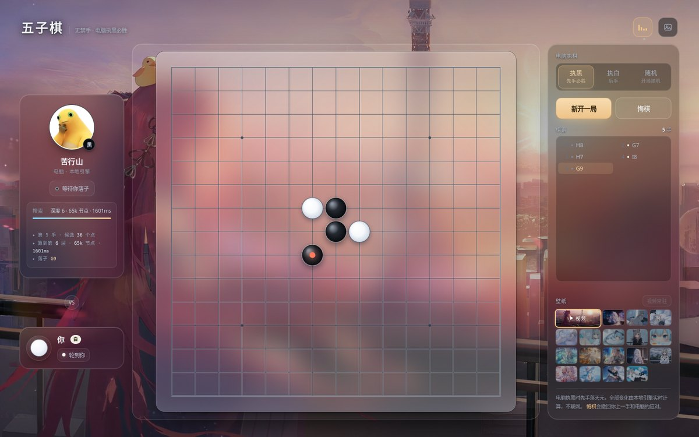

[English](README.md) | [简体中文](README_Simplified_Chinese.md) | [繁體中文](README_Classical_Chinese.md)

# 五子棋 · Gomoku

此乃純本地之網頁五子棋也。雙擊 `gomoku.html` 即可對弈，不待聯網，不煩安裝，亦無外依。

機亦能弈，且**執黑幾不可勝**。其腹中藏一 Alpha-Beta 之器：九格棋形查表、增量勢能之評、置換之表、VCF 連沖四之算，皆備焉，非背譜者也。



---

## 起手

1. 解壓全卷（**勿獨取 `gomoku.html`**，背景之圖與絲竹之聲，皆在 `assets/` 中）。
2. 雙擊 `gomoku.html`，以 Chrome、Edge、Safari 或 Firefox 啟之。
3. 徑點棋枰落子，機自應之。

初啟之時，樂聲自起。若瀏覽器禁其自鳴，則點頁面一處，聲乃出。

---

## 目錄之序

```
gomoku/
├── gomoku.html          棋之本體（HTML、CSS、JS 與算器，皆內嵌）
├── README.md            此卷
└── assets/
    ├── bgm.mp3          背景之樂《屋頂上的苦行山》
    ├── avatar-ai.png    機之頭像
    ├── preview.jpg      界面預覽（止為此卷而設，可刪）
    ├── audio/
    │   ├── end-laugh.mp3 終局之聲（局終則鳴）
    │   └── undo.mp3      悔棋之聲（按「悔棋」則鳴）
    ├── video/           動影之背景
    │   ├── bg-loop.mp4  無接縫之循環動影（1600×900 / 30fps / 約 7MB）
    │   ├── poster.jpg   動影之封
    │   └── thumb.jpg    壁紙牆中之縮圖
    └── bg/              背景圖十七張
        ├── bg01.jpg
        ├── bg02.png
        └── …
```

---

## 界面之制

```
┌───────────────────────────────────────────────────────────┐
│  五子棋                                     ♪  🖼          │
├──────────┬───────────────────────────┬────────────────────┤
│ 機之卡片  │                           │  汝執黑白 三選一     │
│  頭像     │      毛玻璃棋枰            │  新開一局 / 悔棋     │
│  苦行山   │    （背景圖透過來）        │  棋譜               │
│  狀態     │                           │   壁紙十七張 + 動影  │
│  VS      │                           │                    │
│ 汝（棋子）│                           │                    │
└──────────┴───────────────────────────┴────────────────────┘
```

- **左上**者，敵也，號「苦行山」，獨有其頭像；運思之時，像外之環旋轉不息。
- **左下**者，汝也，不設頭像，止以一子為記，其色隨執黑執白而變。
- **中央**為毛玻璃之棋枰：以 `backdrop-filter` 實時虛化其後之壁紙或動影，使背景之色塊透出，玻璃之緣亦作霧化高光。
- **左右兩側之卡片，亦毛玻璃也**：半透之底，實時之糊，更加一層極細之磨砂。
- **右側**則諸般操持，盡在於是。

---

## 弈法

### 汝執黑乎，執白乎

右側之板三選一，**一易其選，即開新局**：

板上三鈕，所擇者乃**汝**執何方，機取其餘。初啟默為「執白」，是**機執黑而先手**，第一手徑落天元。

| 選項 | 釋 |
|---|---|
| **執黑（汝先手）** | 汝執黑先行，機執白。欲自開局者，取此 |
| **執白（機先手）** | **默然之選**。機執黑先行，此後每一步皆由其算 |
| **隨機（開局隨分）** | 每局隨分，板上示本局之結果 |

### 棋例

- 枰凡十五路，**無禁手**，橫豎斜任一方向連成五子者勝。
- 枰滿而未分勝負，則為和。

### 操持

| 所為 | 其法 |
|---|---|
| 落子 | 點棋枰之交叉處 |
| 悔棋 | 按「悔棋」之鈕，或按 `U` |
| 新開一局 | 按「新開一局」，或按 `N` |
| 換壁紙 | 點右側「壁紙」中任一縮圖；頂欄 🖼 之鈕則換其次張 |
| 動影背景 | 壁紙牆第一格「▶ 動影」，選之則循環而播，且不復自輪 |
| 自輪 | 壁紙右上「自動輪換」之開關，開則每 **一分鐘** 易一張（動影之模式下不輪） |
| 樂聲開闔 | 點右上 ♪ 之鈕 |
| 終局之聲 | 分勝負或和時自鳴，不待操持 |
| 悔棋之聲 | 按「悔棋」時鳴，連按則每自其首而重播 |

**悔棋**一次退兩手：汝方落之子，與機所應之手，仍歸於汝未落之先。局終亦可悔，悔則復入對局之態。

---

## 機之運思（文字版）

枰上不置光圈，亦無光暈，機之所想，徑書於左側卡片之文框中，隨算而更：

```
▸ 第五手 · 候選三十六點
▸ 已算八層 · 六萬二千節
▸ 今看好 G6
```

| 行 | 義 |
|---|---|
| 第一行 | 今為第幾手，盤面之近旁有幾許候選之點與其評 |
| 第二行 | 迭代而深至第幾層，已搜幾許節點 |
| 第三行 | 算之半途曰「今看好」，算畢則為「落子 X」 |

**不強人待**：算器既畢，即刻落子，此行文字留至下一手，故算之速者亦不至一閃而逝。

算器優行於 `Web Worker` 之中，界面未嘗滯礙。若徑雙擊 `gomoku.html`（`file://` 之協議），則瀏覽器不許啟 `Blob Worker`，乃自降為**頁內分片之算**：每深一層，讓主線程一回，故上列三行仍逐層而新，惟深搜之層稍作停頓。

---

## 算法與棋力

算器乃純前端之搜索者：無棋譜之庫，不聯於網，亦無伺服之端。

### 棋形之辨：每一空點、每一方向

落子之先，先答一問——**吾於此點落子，此方向將成何形**。每點之四方向，各取以其為心之九格，編為三進之數（零為空，一為己，二為敵或牆），查一預算之表凡一萬九千六百八十三項，徑得棋形之等：

| 等 | 棋形 | 釋 |
|---|---|---|
| 6 | 五連 | 落子即勝 |
| 5 | 活四 | 有兩成五之點，堵之不得 |
| 4 | 沖四 | 止一成五之點，敵必應之 |
| 3 | 活三 | 下一手可成活四 |
| 2 | 眠三 | 一端被堵之三 |
| 1 | 活二 | 尚可展布 |
| 0 | 無 | — |

此判能識**跳三**「●●_●」、**跳四**「●●_●●」、**兩端俱堵**之形，皆按五格之窗而計者所不能見，是亦其防勝於前版之根本也。

### 落子惟重算所受影響之方向

每一空點，皆守「黑落於此為何等、白落於此為何等」乘四方向，凡一千八百之數。落一子者，止影響同線上下四格內之空點，故一落而止重算三十餘點之單向，其餘原封不動；評分亦隨之增量加減，葉節點取分為 O(1)。

### 勢評：按格而聚，不使沖四刷分

每空點取「最強之向，加〇·四五乘次強之向」為其勢，乃合全枰之空點而計之：

| 棋形 | 權 |
|---|---|
| 活四 | 1,500,000 |
| 沖四 | 26,000 |
| 活三 | 1,200 |
| 眠三 | 80 |
| 活二 | 10 |

按格而聚，不徑合四方向者，蓋後者使「一手可湊數沖四」之點屢屢計分——機將沉溺於一堆為敵隨手所堵之沖四。取「最強之向，加次強之四五」，既存雙三、四三之值，又不為四方向之低形所刷。

五連之點**不入於勢**，別按格而計，蓋「敵下一手可成五」非即「吾勝」，當視輪於誰手。評時：

- 輪於吾而可成五 → 徑與勝分
- 敵有兩成五之點以上（活四）→ 徑與敗分
- 敵止一成五之點 → 吾必往堵，扣其先手之分

又每子皆帶**位置之值**（愈近中央則愈高）。無此一項，則開局之「天元」與「邊上之貼身」等而視之，機將低估先手，執黑反愈下愈虧。

### 搜索

| 機制 | 用 |
|---|---|
| 迭代加深 | 自二層起逐層而深，時至則止，惟存末層之全果 |
| 置換之表 | 六萬四千項之 Zobrist 表，藏「局面 → 分數與最佳著法」 |
| PVS | 首著全窗，餘著零窗試之，越窗則重搜 |
| 殺手著法 | 每層記二著之嘗致剪枝者，優先試之 |
| 候選之裁 | 止觀棋子周遭二格，按「吾落之等，加一·〇五乘敵落之等」為序，取前八至十六 |
| 強制之著 | 能成五則徑下；敵能成五則惟堵；己能成活四則徑下 |
| 分片而行 | 每深一層讓主線程一回，界面得逐層而新「已算 N 層」 |

**守之權稍重於攻**（一·〇五）。敵可成活四之點，必居候選之首，不為己之攻所擠——此「不漏防」之要也。

### 殺棋

VCF（連沖四）行於主搜之前：多不過十八層，限時四百二十毫秒。苟有「一路沖四以至成五」之強途，則徑落之。遞歸之中，察敵能否反成五，以免算出假殺。

落子之前復有一自檢：依所選之著行一步，再以敵之視角行一次 VCF。若敵能連沖四以殺，則易第二、第三之候。此一步專治「貌似大優、實則送殺」之棋。

### 實測

同程對打，不加擾動，每步限時：

| 敵手 | 結果 |
|---|---|
| 循例之守 AI（成五、堵五、堵活四，幾不漏殺） | 執黑 5 : 0 |
| 循例而自帶連沖四殺者（頗似能算殺之人，隨機而變） | 執黑 18 : 0 |
| 本版算器自身，而白方多與二秒（3200 對 5200） | 執黑 3 : 0 |
| 本版算器自身（白方 1800ms） | 執黑 2 : 0 |
| 前版算器（1600ms） | 執黑 4 : 0 |
| 黑方止與 1200ms，對「循例加沖四殺」 | 執黑 6 : 0 |

瀏覽器中復作兩番實測：

- 以腳本摹**隨意落子**之弈者：十一至十三手而殺終。
- 以腳本摹**守規之弈者**（能成五則成五，汝將成五則堵，餘按鄰近而行）：連四局皆機勝，九至十一手而殺終。

### 論「必勝」

- 頁面默使機執黑（汝執白），啟之即見其先手落天元；開局前六手另與〇·九秒，以免開局走散。
- 此乃**工程意義之強保**：累計四十餘局，對「循例之守 AI / 能算沖四殺之循例者 / 前版算器 / 其自身（且讓白方多二秒）」，機執黑全勝，無一局見逼和或見負。
- 然非數學之證。無禁手之五子棋，黑方於理必勝，而以 JS 於三秒之內窮盡驗之，實所不能；理上仍或有專攻其隙之走法。日常對局，不必望勝之。
- 機執白時不保必勝——先手之利在黑，執白而能勝，乃合理也。

## 自定

皆在 `gomoku.html` 之中，以文書之器搜其相應之處即是：

| 所欲改 | 所當搜 | 釋 |
|---|---|---|
| 運思之長 | `aiThinkTime` | 黑 3200ms、白 1800ms，開局前六手再加 900ms；調之則強而緩 |
| 搜索之深限 | `maxDepth: 14` | 頁面授於算器之層限，實深則為時所限 |
| VCF 之深與時 | `findVCFMove(me, 18, Math.min(420, …))` | 連沖四之層數與耗時之限 |
| 樂聲之量 | `audio.volume` | 默 `0.34`，其域自 0 至 1 |
| 棋枰之色 | `paintScene` | 今為半透中性之玻璃，配深藍灰之格；欲易木色，則改此處之漸 |
| 棋枰之通透 | `glassAlpha` | 圖則 0.06 至 0.15，動影則定 0.13，值愈小則愈透 |
| 棋枰之糊 | `.board-box` 之 `backdrop-filter` | 默 `blur(26px) saturate(1.38) brightness(1.01)` |
| 卡片之毛玻璃 | `.card` 之 `backdrop-filter` | 默 `blur(32px) saturate(1.65) brightness(1.06)`，配 `background-color` 約 0.38 |
| 圖輪之期 | `60000` | 自輪之毫秒數，今為一分鐘 |
| 背景之虛 | `.bg-layer` 之 `filter:blur(3.5px)` | 改為 0 則背景全清（將奪畫面） |
| 易背景圖 | `BG_LIST` 之陣 | 置汝圖於 `assets/bg/`，改陣中之名 |
| 易背景動影 | `VIDEO_BG` | 默 `assets/video/bg-loop.mp4`，同名而代可也 |
| 易樂 | `assets/bgm.mp3` | 徑同名而代 |
| 易終局之聲 | `assets/audio/end-laugh.mp3` | 徑同名而代，其長隨意 |
| 易悔棋之聲 | `assets/audio/undo.mp3` | 同上，今為〇·八六秒之短音 |
| 終局之聲之量 | `playEndSfx` 中之 `sfx.volume` | 默 `1`，嫌其喧則調至 0.5 許 |
| 悔棋之聲之量 | `playUndoSfx` 中之 `undoSfx.volume` | 默 `0.9` |
| 樂聲讓位之度 | `playEndSfx` 中之 `audio.volume = 0.09` | 笑聲之際，背景之樂壓至此量 |
| 棋枰之路 | `var N = 15` | 注意：星位之坐標寫死於 `paintScene`，改路數則須同調 |

背景之擇，存於瀏覽器之 `localStorage`（鍵名 `gomoku_bg`），圖記其序，動影記曰 `video`，下次啟之，仍前次之物。

---

## 常見之問

**啟之而空白，或棋枰不現？**
用今世之瀏覽器（Chrome 80+、Edge 80+、Safari 14+、Firefox 78+）。IE 不之能，蓋需 `Web Worker` 與 `Canvas`。

**無背景之圖，亦無樂聲？**
多為止取 `gomoku.html` 一卷。以 `assets/` 之卷並置同級之目可也。資源既闕，棋仍可弈，惟無背景與聲耳。

**背景動影不播，或見滯礙？**
動影乃靜音而循環者，瀏覽器許其自播；若汝曾手止之，或系統之省電模式限之，點頁面一處即復。影凡 1600×900，於舊機視 4K 為便；移於背景則自止，歸則續播。

**局既終而不聞笑聲？**
聲於勝負既揭之後約〇·二四秒而鳴（待落子之動收其尾）。若瀏覽器禁未嘗點過之頁發聲，則點棋枰或「再來一局」以解之；點「再來一局」則笑聲立斷，此其常也。

**悔棋而無聲？**
二者皆常：一則枰上尚無汝之子（惟機開局那一手），此時「悔棋」本無可悔；二則瀏覽器未解其聲，初點棋枰之後即復。

**樂聲不自鳴？**
瀏覽器自播之策限之，點頁面一處即起。此其常行，非病也。

**手機之上可弈乎？**
可。窄屏則自改為上下之局，棋枰隨其寬，鈕之位亦調。橫屏縱屏皆宜。

**棋枰之毛玻璃變為半透之白板？**
毛玻璃者，賴 CSS 之 `backdrop-filter`。Safari 14+、Chrome 76+、Firefox 103+ 皆能之；其更舊者則自降為半透之底，棋子照常可下，惟無模糊之效。

**棋譜中黑棋何以為灰藍之圓點？**
面板之底深，純黑之點不可見。枰上之黑棋，仍正黑也。

---

## 技術之記

- 單卷之前端，無依、無構、無網路之求。
- 繪：`Canvas 2D`，按 `devicePixelRatio` 而縮，高分之屏不糊；棋枰半透而繪，外層 `.board-box` 以 `backdrop-filter` 作磨砂之玻璃。
- 壁紙：雙 `div` 交叉而淡入淡出，易時按圖之平均明度自調其暗蒙與玻璃之厚。
- 動影背景：`<video muted loop playsinline>` 鋪滿視口，首尾一秒半作交叉之淡，故循環無跳幀；入動影之模式則止圖之輪，移於背景則自止。
- 算：`Web Worker`（算器之碼以 `text/js-worker` 內嵌，經 `Blob` 而啟）；`file://` 下 Worker 被阻時，自降為頁內分片之算（`searchBegin` / `searchStep`，逐層讓主線程）。
- 法：九格棋形之查表，加增量威脅之勢，加 Alpha-Beta/PVS，加迭代加深，加置換之表（Zobrist 64K），加殺手著法，加 VCF，皆純 JS，無所依。
- 樂：`<audio loop>`，`preload="auto"`；終局之聲與悔棋之聲，別為二 `<audio>`。笑聲之時，背景之樂自 0.34 壓至 0.09，聲畢或開新局則自復；悔棋之聲止〇·八六秒，不壓背景之樂。
- 資源：背景圖十七張（jpg、png、webp 相雜），背景動影約 7MB，樂約 7MB，終局之聲 80KB，悔棋之聲 8KB，全卷約 18MB。

---

## 許可

[MIT](LICENSE)
