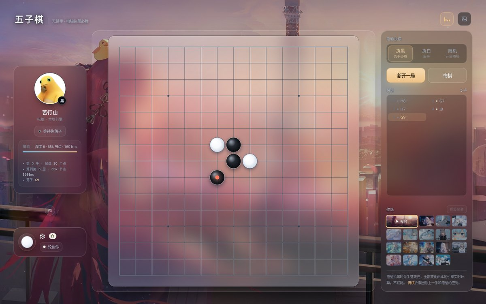

[English](README.md) | [简体中文](README_Simplified_Chinese.md) | [繁體中文](README_Classical_Chinese.md)

# 五子棋 · Gomoku

一个纯本地的网页五子棋。双击 `gomoku.html` 就能玩，不联网、不需安装、无第三方依赖。

电脑会下棋，而且**执黑时基本不可能输**——它自带一个 Alpha-Beta 引擎（9 格棋型查表 + 增量势能评估 + 置换表 + VCF 连续冲四），不是靠背棋谱。



---

## 快速开始

1. 解压整个文件夹（**不要只拿 `gomoku.html`**，背景图和音乐在 `assets/` 里）。
2. 双击 `gomoku.html`，用 Chrome / Edge / Safari / Firefox 打开。
3. 直接点棋盘落子。电脑会自动应手。

页面首次打开会自动播放背景音乐。若浏览器拦截了自动播放，点一下页面任意位置即可开始。

---

## 目录结构

```
gomoku/
├── gomoku.html          游戏本体（HTML + CSS + JS + 引擎，全部内联）
├── README.md            本文件
└── assets/
    ├── bgm.mp3          背景音乐《屋顶上的苦行山》
    ├── avatar-ai.png    电脑头像
    ├── preview.jpg      界面预览图（仅 README 用，可删）
    ├── audio/
    │   └── end-laugh.mp3 终局音效（对局结束时播放）
    ├── video/           视频背景
    │   ├── bg-loop.mp4  无循环接缝的背景视频（1600×900 / 30fps / 约 7MB）
    │   ├── poster.jpg   视频封面
    │   └── thumb.jpg    壁纸墙里的视频缩略图
    └── bg/              17 张背景图
        ├── bg01.jpg
        ├── bg02.png
        └── …
```

---

## 界面布局

```
┌──────────────────────────────────────────────────────────┐
│  五子棋                                    ♪  🖼          │
├──────────┬──────────────────────────┬────────────────────┤
│ 电脑卡片  │                          │  你执 三选一     │
│  头像     │      毛玻璃棋盘           │  新开一局 / 悔棋     │
│  苦行山   │   （背景图透过来）         │  棋谱               │
│  状态     │                          │  壁纸 17 张 + 视频   │
│  VS      │                          │                     │
│ 你（棋子）│                          │                     │
└──────────┴──────────────────────────┴────────────────────┘
```

- **左侧上方**是对手「苦行山」，唯一带头像的一方，思考时头像外圈会转。
- **左侧下方**是你自己，用一颗棋子标识代替头像，颜色跟着执黑/执白变。
- **中间**是毛玻璃棋盘：`backdrop-filter` 实时虚化背后的壁纸或视频，透出背景的色块，玻璃边缘做了雾化和高光。
- **左右两侧的卡片同样是毛玻璃**：半透明底 + 实时模糊 + 一层极细的磨砂颗粒。
- **右侧**是全部控制项。

---

## 玩法

### 你执黑还是执白

右侧面板三选一，**切换即开新局**：

面板上的三个按钮选的是**你**执哪一方，电脑拿另一方。打开页面时默认是「执白」——也就是**电脑执黑先手**，第一手直接落天元。

| 选项 | 说明 |
|---|---|
| **执黑（你先手）** | 你执黑先走，电脑执白。想自己开局就选这个 |
| **执白（电脑先手）** | **默认项**。电脑执黑先走，之后每一步都由它算 |
| **随机（开局随机）** | 每局随机分配，面板会显示本局结果 |

### 规则

- 15×15 棋盘，**无禁手**，横竖斜任意方向连成五子即胜。
- 棋盘下满未分胜负为平局。

### 操作

| 操作 | 方式 |
|---|---|
| 落子 | 点击棋盘交叉点 |
| 悔棋 | 点「悔棋」按钮，或按 `U` |
| 新开一局 | 点「新开一局」，或按 `N` |
| 换壁纸 | 点右侧「壁纸」里的任意缩略图；顶栏 🖼 按钮切下一张 |
| 视频背景 | 壁纸墙第一个格子「▶ 视频」，选中后循环播放，且不再自动轮换 |
| 自动轮换 | 壁纸右上角的「自动轮换」开关，开启时每 **1 分钟**换一张（视频模式下不轮换） |
| 音乐开关 | 点右上角 ♪ 按钮 |
| 终局音效 | 分出胜负或平局时自动播放，无需操作 |

**悔棋**一次会退掉两手：你刚下的一手 + 电脑的应手，回到你落子之前的局面。对局结束后也能悔棋，会重新进入对局状态。

---

## 电脑思考过程（文字版）

棋盘上不放任何光圈或光晕，电脑的想法直接写在左侧卡片的文本框里，边算边更新：

```
▸ 第 5 手 · 候选 36 个点
▸ 已算 8 层 · 62.0k 节点
▸ 当前看好 G6
```

| 行 | 含义 |
|---|---|
| 第 1 行 | 当前第几手、盘面附近有多少个候选点参与评估 |
| 第 2 行 | 迭代加深到第几层、已经搜了多少节点 |
| 第 3 行 | 搜索中途是「当前看好」，算完变成「落子 X」 |

**不强制等待**：引擎算完立即落子，这行文字会保留到下一手，所以算得快也不会一闪而过。

引擎优先跑在 `Web Worker` 里，界面完全不卡。直接双击 `gomoku.html`（`file://` 协议）时浏览器不允许启动 `Blob Worker`，会自动切到**页面内分片计算**：每加深一层就让出一次主线程，所以上面这三行照样逐层刷新，只是深搜那一层会短暂停顿。

---

## 算法与强度

引擎是纯前端搜索器：没有棋谱库、没有联网、没有服务端。

### 棋型识别：每个空点、每个方向

落子前先回答一个问题——**我在这点落子，这个方向会变成什么**。每个点的 4 个方向各取以它为中心的 9 格，编码成三进制数（0 空 / 1 己方 / 2 敌方或墙），查一张 19683 项的预计算表，直接得到棋型等级：

| 等级 | 棋型 | 含义 |
|---|---|---|
| 6 | 五连 | 落子即胜 |
| 5 | 活四 | 两个成五点，堵不住 |
| 4 | 冲四 | 一个成五点，对手必须应 |
| 3 | 活三 | 下一手能成活四 |
| 2 | 眠三 | 一端被堵的三 |
| 1 | 活二 | 还能发展 |
| 0 | 无 | — |

这套判定能认出**跳三**「●●_●」、**跳四**「●●_●●」、**两端被堵**这些按 5 格窗口统计看不出来的形状，也是它比上一版更会防守的根本原因。

### 落子只重算受影响的方向

每个空格都要维护「黑落这里是什么等级、白落这里是什么等级」× 4 个方向，共 1800 个数。落一颗子只影响同线 ±4 格内的空格，所以一次落子只重算 30 来个点的单个方向，其余原封不动；评估分同步做增量加减，叶节点 O(1) 取分。

### 评估：按格聚合，不让冲四刷分

每个空格取「最强方向 + 0.45 × 次强方向」作为该格势能，再把全盘空格加起来：

| 棋型 | 权重 |
|---|---|
| 活四 | 1,500,000 |
| 冲四 | 26,000 |
| 活三 | 1,200 |
| 眠三 | 80 |
| 活二 | 10 |

按格聚合、而不是把 4 个方向直接相加，是因为后者会让「一手能凑出好几个冲四」的点被反复计分——电脑会沉迷于下一堆被对手随手堵掉的冲四。取「最强方向 + 次强方向的 0.45」既保留了双三、四三这种组合的价值，又不会被四个方向的低价值棋型刷分。

五连点**不进势能**，单独按格计数，因为「对手下一手能成五」不等于「我赢」，得看轮到谁走。评估时：

- 轮到我能成五 → 直接给胜分
- 对手有两个以上成五点（活四）→ 直接给败分
- 对手只有一个成五点 → 我必须去堵，扣掉先手分

另外每颗子都带**位置价值**（越靠中心越高）。没有这一项，开局「天元」和「边上的贴身子」会被算成一样平，电脑会低估先手，执黑反而越下越亏。

### 搜索

| 机制 | 作用 |
|---|---|
| 迭代加深 | 2 层起逐层加深，时间到就停，只保留最后一层的完整结果 |
| 置换表 | 64K 项 Zobrist 表，缓存「局面 → 分数 + 最佳着法」 |
| PVS | 第一个着法全窗口，其余零窗口试探，超窗重搜 |
| 杀手着法 | 每层记两个刚造成剪枝的着法，优先试 |
| 候选裁剪 | 只看棋子周围 2 格内，按「我落子的等级 + 1.05 × 对手落子的等级」排序，取前 8–16 个 |
| 强制着法 | 能成五直接下；对手能成五只考虑堵点；自己能成活四直接下 |
| 分片执行 | 每加深一层就让出一次主线程，界面能逐层刷新「已算 N 层」 |

**防守权重略高于进攻**（1.05）。对手能成活四的点一定排在候选最前面，不会被自己的进攻挤掉——这是「不漏防」的关键。

### 杀棋

VCF（连续冲四）在主搜索之前跑：最多 18 层、限时 420ms。只要存在「一路冲四直到成五」的强制路线就直接落子。递归中会检查对手是否反成五，避免算出假杀。

落子前还有一道自检：按选定的着法走一步，再用对手视角跑一次 VCF。如果对手能连续冲四杀死，就换第二、第三候选。这一步专治「看起来大优、其实是送杀」的棋。

### 实测

同进程对打，无随机扰动，每步限时：

| 对手 | 结果 |
|---|---|
| 规则型防守 AI（成五 / 堵五 / 堵活四，几乎不漏杀） | 执黑 5 : 0 |
| 规则型 + 自带连续冲四杀（更像会算杀的人，随机变化） | 执黑 18 : 0 |
| 本版引擎自身，且白方多给 2 秒（3200 vs 5200） | 执黑 3 : 0 |
| 本版引擎自身（白方 1800ms） | 执黑 2 : 0 |
| 上一版引擎（1600ms） | 执黑 4 : 0 |
| 黑方只给 1200ms，对「规则 + 冲四杀」 | 执黑 6 : 0 |

浏览器里另做了两轮实测：

- 脚本模拟**随机落子**的玩家：11–13 手杀棋结束。
- 脚本模拟**守规矩的玩家**（能成五就成五、你会成五就堵、其余按邻近度走）：连续 4 局全部电脑胜，9–11 手杀棋结束。

### 关于「必胜」

- 页面默认就让电脑执黑（你执白），打开就能看到它先手落天元；开局前 6 手额外多给 0.9 秒，避免开局走散形。
- 这是**工程意义上的强保证**：累计四十余局对「规则型防守 AI / 会算冲四杀的规则型 / 上一版引擎 / 它自己（还让白方多 2 秒）」，电脑执黑全胜，没有一局被逼和或输棋。
- 但不是数学证明。无禁手五子棋黑方理论必胜，用 JS 在 3 秒内穷尽验证并不现实，理论上仍可能存在专门针对它的走法；日常对局里不用指望赢它。
- 电脑执白时不保证必胜——先手优势在黑方，执白能赢才合理。

## 自定义

都在 `gomoku.html` 里，用文本编辑器搜索对应位置即可：

| 想改什么 | 搜什么 | 说明 |
|---|---|---|
| 思考时长 | `aiThinkTime` | 黑 3200ms / 白 1800ms，开局前 6 手再加 900ms；调大变强、变慢 |
| 搜索深度上限 | `maxDepth: 14` | 页面传给引擎的层数上限，实际深度受时间限制 |
| VCF 深度 / 时限 | `findVCFMove(me, 18, Math.min(420, …))` | 连续冲四的层数与耗时上限 |
| 音乐音量 | `audio.volume` | 默认 `0.34`，范围 0–1 |
| 棋盘配色 | `paintScene` | 现在是半透明中性玻璃 + 深蓝灰网格，想换木色改这里的渐变 |
| 棋盘通透度 | `glassAlpha` | 图片 0.06–0.15、视频固定 0.13，值越小越透 |
| 棋盘模糊 | `.board-box` 的 `backdrop-filter` | 默认 `blur(26px) saturate(1.38) brightness(1.01)` |
| 卡片毛玻璃 | `.card` 的 `backdrop-filter` | 默认 `blur(32px) saturate(1.65) brightness(1.06)`，配套 `background-color` 约 0.38 |
| 图片轮换周期 | `60000` | 自动轮换的毫秒数，现在是 1 分钟 |
| 背景虚化 | `.bg-layer` 的 `filter:blur(3.5px)` | 改 0 则背景全清晰（会抢画面） |
| 换背景图 | `BG_LIST` 数组 | 把你的图放进 `assets/bg/`，改数组里的文件名 |
| 换背景视频 | `VIDEO_BG` | 默认 `assets/video/bg-loop.mp4`，同名替换即可 |
| 换音乐 | `assets/bgm.mp3` | 直接同名替换即可 |
| 换终局音效 | `assets/audio/end-laugh.mp3` | 直接同名替换即可，时长随意 |
| 终局音效音量 | `playEndSfx` 里的 `sfx.volume` | 默认 `1`，嫌吵调到 0.5 左右 |
| 音乐让位幅度 | `playEndSfx` 里的 `audio.volume = 0.09` | 笑声期间背景音乐压低到的音量 |
| 棋盘路数 | `var N = 15` | 注意：星位坐标写死在 `paintScene` 里，改路数需同步调整 |

背景选择会存在浏览器 `localStorage`（键名 `gomoku_bg`），图片记序号、视频记 `video`，下次打开还是上次那个。

---

## 常见问题

**打开是空白页 / 棋盘不显示？**
用现代浏览器（Chrome 80+、Edge 80+、Safari 14+、Firefox 78+）。IE 不支持，需要 `Web Worker` 和 `Canvas`。

**没有背景图、没有音乐？**
多半是只拷了 `gomoku.html`。把 `assets/` 文件夹一起放在同级目录。缺资源时游戏本身仍能正常玩，只是没背景和声音。

**视频背景不播放 / 卡顿？**
视频是静音循环的，浏览器允许自动播放；若你手动暂停过或系统省电模式限制，点一下页面即可恢复。视频 1600×900，对老机器比 4K 友好得多；切到后台会自动暂停，回来接着播。

**对局结束了但没听到笑声？**
音效在胜负揭晓后约 0.24 秒播放（等落子动画收尾）。若浏览器拦截了未被点击过的页面发声，点一下棋盘或「再来一局」即可解锁；点「再来一局」会立刻切断笑声，这是正常的。

**音乐不自动播放？**
浏览器的自动播放策略限制，点一下页面任意位置就会开始。这是正常行为，不是 bug。

**手机上能玩吗？**
能。窄屏会自动改为上下布局，棋盘自适应宽度，按钮位置也会调整。建议横屏或竖屏均可。

**棋盘的毛玻璃变成了半透明白板？**
毛玻璃依赖 CSS `backdrop-filter`。Safari 14+、Chrome 76+、Firefox 103+ 都支持；更老的浏览器会自动退化成一块半透明底板，棋子照常能下，只是没有模糊效果。

**棋谱里黑棋为什么是灰蓝色圆点？**
面板底色深，纯黑圆点看不见。棋盘上的黑棋仍是正常黑色。

---

## 技术信息

- 单文件前端，零依赖、零构建、零网络请求。
- 渲染：`Canvas 2D`，按 `devicePixelRatio` 缩放，高分屏不糊；棋盘为半透明绘制，外层 `.board-box` 用 `backdrop-filter` 做磨砂玻璃。
- 壁纸：双 `div` 交叉淡入淡出，切换时按图片平均亮度自动调整压暗蒙版与玻璃厚度。
- 视频背景：`<video muted loop playsinline>` 铺满视口，首尾 1.5 秒做了交叉淡化，循环没有跳帧；进入视频模式后停止图片轮换，切后台自动暂停。
- 计算：`Web Worker`（引擎代码以 `text/js-worker` 内联，通过 `Blob` 启动）；`file://` 下 Worker 被拦时自动降级为页面内分片计算（`searchBegin` / `searchStep`，逐层让出主线程）。
- 算法：9 格棋型查表 + 增量威胁势能 + Alpha-Beta/PVS + 迭代加深 + 置换表（Zobrist 64K）+ 杀手着法 + VCF，全部纯 JS、无依赖。
- 音乐：`<audio loop>`，`preload="auto"`；终局音效是独立的 `<audio>`，播放时把背景音乐从 0.34 压到 0.09，放完或开新局自动恢复，两者互不打断。
- 资源：背景图 17 张（jpg/png/webp 混合）、背景视频约 7MB、音乐约 7MB、终局音效 80KB，整个包约 18MB。

---
## 许可证

[MIT](LICENSE)
